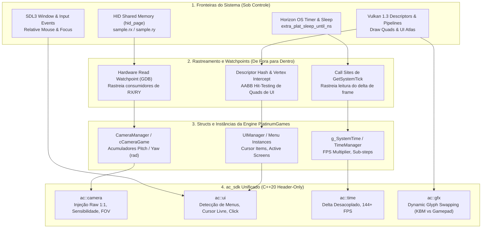

# Roadmap Técnico: Construção do mini-SDK (`ac_sdk`) — De Fora para Dentro

Este documento estabelece o roadmap técnico e a estratégia de engenharia reversa para a criação do **`ac_sdk`** no **AstralChain-PC**.

Para transformar os blocos brutos da recompilação do *Astral Chain* em um mini-SDK próprio e modular sem se perder nas dezenas de milhares de funções não documentadas (`sub_71...`) do binário ARM64, o caminho mais eficiente é **atacar de fora para dentro**: partindo das fronteiras de sistema que já controlamos no runtime nativo Linux (`nnSdk`, Horizon IPC/Shared Memory e Vulkan 1.3) rumo às structs e objetos internos da engine da PlatinumGames.

---

## 1. Visão Geral e Estrutura Arquitetural

No processo de recompilação estática, o executável é traduzido em massa para C/C++, gerando um mar de símbolos anônimos. Abordagens ingênuas de engenharia reversa "de baixo para cima" (tentar decodificar função por função a partir do ponto de entrada) são inviáveis.

Por outro lado, o runtime nativo Linux do AstralChain-PC já governa com precisão cirúrgica:
1. **A página compartilhada de HID (`hid_page`)** em [`src/runtime/input/hid_service.h`](file:///home/shadowy/Documentos/GitHub/AstralChain-PC/src/runtime/input/hid_service.h), onde alimentamos `sample.rx`, `sample.ry` e botões em 125 Hz.
2. **O pipeline de renderização Vulkan 1.3** em [`src/runtime/las/nvn/vulkan/`](file:///home/shadowy/Documentos/GitHub/AstralChain-PC/src/runtime/las/nvn/vulkan/), onde capturamos draw calls, pipelines de vertex/fragment e descritores de texturas.
3. **O subsistema de plataforma SDL3** em [`src/hooks/sdl/window_trampoline.h`](file:///home/shadowy/Documentos/GitHub/AstralChain-PC/src/hooks/sdl/window_trampoline.h) e [`src/hooks/input/mouse_mode.h`](file:///home/shadowy/Documentos/GitHub/AstralChain-PC/src/hooks/input/mouse_mode.h), que recebe eventos nativos do SO.

Ao posicionar pontos de interceptação (watchpoints de memória e inspeção de descriptors) nessas fronteiras conhecidas, rastreamos o fluxo de dados diretamente para o coração das structs da engine.



---

## 2. As 5 Fases do Roadmap

---

### Fase 1: Mineração Estática e Mapa de Símbolos Base [CONCLUÍDA]

Antes de abrir o debugger, extraímos tudo o que o binário ARM64 ainda preserva em texto e estruturas de compilação para alimentar o pipeline com identificadores legíveis.

1. **Extração de Vtables e Tratamento de RTTI:**
   * **Constatação Técnica**: A varredura na seção `.rodata` (`[0xa0f000, +0x325848)`) confirmou a ausência de strings `_ZTS`/`_ZTI` (compilação retail do Switch realizada com `-fno-rtti`).
   * **Mapeamento de Vtables**: Mapeada a vtable central de câmera em `0xd5b3d0` (138 métodos virtuais), identificando o método de atualização 14 (`0x27f640`), o despachante (`0x28b120`) e Free Camera (`0x2bd8b0`).
2. **Assinaturas da Engine Platinum (`.dat` / `.bxm` / `.uid` / `.wmb`) e `symbols.toml`:**
   * Criada a ferramenta automatizada [`tools/qa/extract_symbols.py`](file:///home/shadowy/Documentos/GitHub/AstralChain-PC/tools/qa/extract_symbols.py) com indexação bitwise de instruções `ADRP` em `.text` e detecção de prólogos de funções ARM64.
   * Catalogados **532 sites de parsers de recursos** e **19 sites de debug/sistema** da engine, gerando o arquivo estruturado [`docs/symbols.toml`](file:///home/shadowy/Documentos/GitHub/AstralChain-PC/docs/symbols.toml).
   * Identificados pontos de entrada das rotinas de carregamento de UI (`0x90e830` e `0x9173a0` para `%s%04x.uid`), hash de recursos Platinum (`0x91e170`), carregador de recursos (`0x9c3e90`) e parsers de propriedades XML binárias (`.bxm`).

---

### Fase 2: Rastreamento de Input e Câmera (Raw Mouse Nativo)

O maior salto em qualidade de vida no PC consiste em remover o controle de câmera da emulação de analógico de gamepad e injetar deltas de mouse diretamente nos acumuladores angulares internos.

1. **Watchpoint no Buffer do `nn::hid`:**
   * No runtime Linux, a função [`hid_publish`](file:///home/shadowy/Documentos/GitHub/AstralChain-PC/src/runtime/input/hid_service.h#L200) grava as amostras de analógico direito nos anéis da memória compartilhada:
     ```c
     sample.rx = ...; sample.ry = ...;
     hid_ring_write((HidRing*)(npad + 0x28), &sample);
     hid_ring_write((HidRing*)(npad + 0x1408), &sample);
     ```
   * No GDB/LLDB, posicionar um *hardware read watchpoint* (`rwatch`) no endereço correspondente a `sample.rx` dentro da `gmem`.
   * Registrar a primeira função `sub_71...` que lê esses inteiros de 16 bits e os normaliza para ponto flutuante no intervalo `[-1.0, 1.0]`.
2. **Localizar a Struct da Câmera Ativa:**
   * Seguir a propagação desse `float` por 2 a 3 níveis na pilha de chamadas até encontrar o bloco de memória onde os ângulos de *pitch* e *yaw* (em radianos) são incrementados frame a frame.
   * Validar a hipótese alterando ou congelando os floats via debugger em tempo real.
   * Identificada a estrutura, mapear o ponteiro base dessa instância (`CameraManager` ou `cCameraGame`) no SDK.
3. **Injeção Direta:**
   * Implementar hook direto na rotina de atualização de câmera:
     ```cpp
     // Injeção de mouse 1:1 sem deadzone ou interpolação de stick
     if (!ac::ui::is_paused()) {
         camera->yaw   += mouse_delta_x * sensitivity_x;
         camera->pitch += mouse_delta_y * sensitivity_y;
     }
     ```
   * Bypass completo das curvas de aceleração, saturação e zonas mortas herdadas de controles físicos.

---

### Fase 3: Isolamento de Estado de Jogo e Menus (Foco e Cursor)

Para que o cursor e o foco da janela reajam com precisão de desktop, o runtime precisa reconhecer com exatidão o estado operacional da engine (Gameplay ativo, Menu de Pausa, Telas de Diálogo/Cutscene ou Tela de Título).

1. **Encontrar a Flag Global ou Instância de Estado:**
   * Conforme evidenciado em [`docs/reverse-engineering-ui-perf.md`](file:///home/shadowy/Documentos/GitHub/AstralChain-PC/docs/reverse-engineering-ui-perf.md#L45), a UI do jogo é orientada a objetos (instâncias manipuladoras como `0x625e60` e `0x61bed8`).
   * Executar scans diferenciais de memória na `gmem` alternando entre gameplay livre e menus abertos para isolar a bitflag de pausa ou o ponteiro do gerenciador de interface ativa.
   * Com o estado exposto no SDK:
     - Chamar `SDL_SetRelativeMouseMode(true)` durante a exploração e o combate (cursor capturado e oculto).
     - Liberar o cursor do sistema operacional (`SDL_SetRelativeMouseMode(false)`) imediatamente ao abrir menus ou ao perder o foco da janela (`SDL_EVENT_WINDOW_FOCUS_LOST` / `Alt+Tab`).
2. **Hit-Testing via Pipeline de UI do Vulkan:**
   * Interceptar a emissão de vértices 2D de interface no backend Vulkan ([`src/runtime/las/nvn/vulkan/`](file:///home/shadowy/Documentos/GitHub/AstralChain-PC/src/runtime/las/nvn/vulkan/)).
   * Capturar os AABBs (*Axis-Aligned Bounding Boxes*) em coordenadas de tela normalizadas (`[-1, 1]`) correspondentes aos quads desenhados com os slots de botão de lista.
   * Comparar a posição do cursor do mouse com esses AABBs e injetar pulsos virtuais de D-Pad no anel HID até sincronizar a seleção do menu com o ponteiro, emitindo `NpadButton::A` no clique esquerdo.

---

### Fase 4: Desacoplamento de Timers e Frame Pacing (60+ FPS)

Jogos desenvolvidos pela PlatinumGames frequentemente associam rotinas físicas secundárias (corrente astral da Legião, dinâmicas de cabelo e janelas de *Sync Attack*) ao delta-time fixo.

1. **Mapear o Multiplicador de Delta-Time:**
   * Rastrear os call sites de `nn::os::GetSystemTick` e o inicializador de timer identificado em `0x3e3cf4` / `0x91d8a0` ([`docs/fps-cap-144.md`](file:///home/shadowy/Documentos/GitHub/AstralChain-PC/docs/fps-cap-144.md#L35)).
   * Isolar a struct global de tempo (`g_SystemTime` / `deltaTime`).
2. **Corrigir Sub-steps Dependentes de FPS:**
   * Mapear rotinas que empreguem constantes hardcoded (como `1.0f / 60.0f` ou `0.0166667f`) em vez de consultar o delta real do frame.
   * Ajustar o avanço temporal das correntes e da física da Legião para operar com o delta dinâmico fornecido pelo pacer nativo Linux, viabilizando taxas de 120, 144 ou 240 FPS sem distorção na velocidade de gameplay ou na responsividade das ações.

---

### Fase 5: Consolidação do `ac_sdk` e Prompts Dinâmicos

Unificar todas as descobertas em uma camada de abstração limpa, robusta e isolada do código gerado pelo recompiler.

1. **Header Unificado (`ac_sdk.hpp`):**
   * Estruturar o mini-SDK sob namespaces C++20 coesos e autoexplicativos:
     - `ac::memory`: Utilitários de resolução de ponteiros na `gmem` e scans por assinatura de bytes (*AOB scan*), garantindo tolerância a diferenças entre revisões do binário (v1.0.0 vs v1.0.1).
     - `ac::camera`: Estruturas e métodos de leitura/escrita de ângulos, FOV e matrizes de visualização.
     - `ac::ui`: Estados de telas, consultas de pausa e visibilidade do cursor.
     - `ac::time`: Controle do multiplicador de velocidade e medições de delta-time.
2. **Troca Dinâmica de Glifos (Teclado/Mouse vs Controle):**
   * No backend Vulkan, interceptar os hashes ou índices das texturas dos botões do Nintendo Switch (`A`, `B`, `X`, `Y`, `ZL`, `ZR`) no atlas de interface.
   * Substituir dinamicamente as referências de descritor bindless pelos glifos equivalentes de PC (ex.: `E`, `Q`, `LMB`, `RMB`, `Shift`, `Espaço`) sempre que o último evento de entrada provier de teclado ou mouse, restaurando os ícones de gamepad ao detectar movimentação em sticks físicos.

---

## 3. Por Onde Começar Hoje: Plano de Ação Imediato

O investimento de menor esforço e maior retorno visual e de gameplay imediato é a **Fase 2 (Passos 1 e 2)**:

> [!TIP]
> Configurar um watchpoint de leitura em `sample.rx` e `sample.ry` leva poucos minutos no GDB e revela o endereço exato do subsistema de câmera, desbloqueando o controle nativo por mouse.

### Procedimento Prático no GDB

1. **Localizar o Endereço de Escrita do HID:**
   No arquivo [`src/runtime/input/hid_service.h`](file:///home/shadowy/Documentos/GitHub/AstralChain-PC/src/runtime/input/hid_service.h#L242), insira um log temporário ou consulte o ponteiro estático da página:
   ```c
   printf("[HID_DEBUG] npad sample.rx addr: %p\n", (void*)&(((HidSample*)((uint8_t*)hid_page + 0x9a00 + 0x28))->rx));
   ```
2. **Anexar o GDB ao Processo do Jogo:**
   ```bash
   gdb -p $(pidof astral_chain)
   ```
3. **Definir o Read Watchpoint:**
   ```gdb
   # Substitua pelo endereço impresso no log
   (gdb) rwatch *(int16_t*)0x7...
   (gdb) continue
   ```
4. **Capturar o Consumidor:**
   Ao mover o analógico ou disparar um evento de input, o GDB suspenderá a execução exatamente na instrução da engine que consome a coordenada do stick:
   ```gdb
   (gdb) backtrace
   (gdb) disassemble
   ```
5. **Mapear a Struct da Câmera:**
   A partir desse call site, acompanhe o registrador de saída (`s0` ou `w0`) até a função de incremento angular da câmera (`camera->yaw += ...`).

---

## 4. Evidências Empíricas e Mapa de Símbolos Descoberto (v1.0.1)

A pesquisa estática e dinâmica no executável `main` (NSO v1.0.1, `nsobid 4B159F0F7A360669738390EE8657B4F0`) revelou as estruturas exatas da engine da PlatinumGames:

### 4.1 Pipeline de Input e Pad State
* **Polling Horizon Npad**: Funções centralizadas em `0x9ac5dc` (`nn::hid::GetNpadState(JoyDual)`), `0x9adc6c` (FullKey), `0x9ae50c` (Handheld).
* **Conversão e Normalização (Raw -> Float)**: Em `0x9acb64`, 4 instruções `scvtf` convertem simultaneamente os eixos dos sticks (`s0` e `s1` para o stick direito; `s2` e `s3` para o stick esquerdo).
* **`g_PadInputState` (`*[0xdc2000 + 0x540]` / `0xdc2540`)**:
  - `+0x00`: uint32 flags / conectado
  - `+0x0c`: float right_stick_x
  - `+0x10`: float right_stick_y
  - `+0x14`: float left_stick_y
  - `+0x18`: float left_stick_x
  - `+0x20`: uint32 botões pressionados
* **Tabela de Jogadores `pad_state` (`*[0xdc2000 + 0x518]` / `0xdc2518`)**:
  - `0xa0` bytes por slot de jogador (Slot 0 = Jogador 1, Slot 1 = Jogador 2 / Legião Co-op).
  - Getter de vetores de stick: `0x9ad0a0(out_vec4, player_id, stick_id)` (`stick_id = 0` para esquerdo, `1` para direito).

### 4.2 Pipeline de Câmera (`CameraManager` / `cCameraGame`)
* **Vtable do `CameraManager`**: Localizada em `0xd5b3d0` (138 métodos virtuais). O ponteiro RTTI/vtable vive em `[0xdb9578] = 0xd5b3c0` (offset +0x10 para o início dos métodos).
* **Método Virtual 14 (Update Principal da Câmera)**: Em `0x27f640` (`vtable + 0x70`).
  - Chama `0x281dc0`: consome `0x9ad0a0(out, 0, 1)`, aplica curvas e deadzone analógica, gravando deltas filtrados em `camera + 0x8d8` (delta X) e `camera + 0x8e0` (delta Y).
  - Chama `0x28b120` (`CameraDirector::Update`): despacha por jump table em `0xba7a84` (`camera + 0x644`, 237 modos de câmera).
* **Modo de Câmera Livre (`FreeCamera::Update`) em `0x2bd8b0`**:
  - Calcula a rotação angular relativa via `acosf` em `0x2bdc04` (`PLT 0xa0d590`).
  - Interpola com taxa lerp em `[0xb5d000 + 0xfe8]` e grava os ângulos de orientação em `camera + 0xb50` (X), `camera + 0xb54` (Y) e `camera + 0xb58` (Z).
  - Acumulador de pitch em `camera + 0x1284` (limitado a 90° / `0x42b40000`).

### 4.3 Isolamento de Menus e Estado de UI
* **Despacho de Menus (`MenuManager`)**:
  - Abertura de menu: `0x61bf00` (`OpenMenu(menu_type)`), com 13 tipos (0 a 12) despachados por jump table em `0xbe8adc`.
  - Fechamento de menu: `0x61bed8` (`CloseMenu`), grava `-1` (`0xffffffff`) em `*[0xdbec80]` (`0xd82d18`).
* **Flag Global de Detecção de Menu**:
  ```cpp
  int32_t active_menu = *(int32_t*)(gmem + 0xd82d18);
  bool is_menu_open   = (active_menu >= 0);
  ```
  Quando `active_menu == -1`, o jogo está em gameplay puro (habilitar `SDL_SetRelativeMouseMode(true)`). Ao abrir qualquer menu (`>= 0`), o cursor é liberado instantaneamente.

### 4.4 Pacing e Timers da Engine (`TimerManager`)
* **Singleton `TimerManager`**: Instância global em `*(void**)(gmem + 0xdb89a0)` = `gmem + 0xdcbfd0`.
* **Inicializador de Framerate**: Em `0x3e3d08`, instrução `fmov s0, #30.0` chama `0x91d8a0`.
  - `[TimerManager + 0xdc]`: `1.0f / target_delta_ms`.
* **Loop de Medição Monotônica (`TimerManager::Update`) em `0x91dbd0`**:
  - Lê `nn::os::GetSystemTick()` em `0x91dbd0`, calcula a diferença contra o tick anterior (`+0xc8`), divide pela frequência de tick em `[0xdc1be0]` e multiplica por 1000.0f.
  - `[TimerManager + 0xe0]`: tempo real decorrido no frame em milissegundos (`delta_ms`).
  - `[TimerManager + 0xd0]`: multiplicador normalizado de frame.
  - `[TimerManager + 0xb0 .. 0xc0]`: escalas de tempo dos subsistemas (velocidade do jogo, slow motion e IRIS).

---

## 5. Relação com Outros Documentos do Projeto

- [`docs/architecture.md`](file:///home/shadowy/Documentos/GitHub/AstralChain-PC/docs/architecture.md): Arquitetura global, subsistemas Horizon e fronteiras C/C++.
- [`docs/reverse-engineering-pc.md`](file:///home/shadowy/Documentos/GitHub/AstralChain-PC/docs/reverse-engineering-pc.md): Análise estática do binário, convenções de endereço e call sites.
- [`docs/reverse-engineering-ui-perf.md`](file:///home/shadowy/Documentos/GitHub/AstralChain-PC/docs/reverse-engineering-ui-perf.md): Evidências estáticas sobre objetos de menu, shaders e ausência de flag global simples.
- [`docs/plan-mouse-menu.md`](file:///home/shadowy/Documentos/GitHub/AstralChain-PC/docs/plan-mouse-menu.md): Implementação da camada de mouse e navegação de menus via HID.
- [`docs/fps-cap-144.md`](file:///home/shadowy/Documentos/GitHub/AstralChain-PC/docs/fps-cap-144.md): Diagnóstico dos limitadores de framerate e pacing de frames.
- [`docs/roadmap-linux.md`](file:///home/shadowy/Documentos/GitHub/AstralChain-PC/docs/roadmap-linux.md): Roadmap geral da adaptação Linux First.
